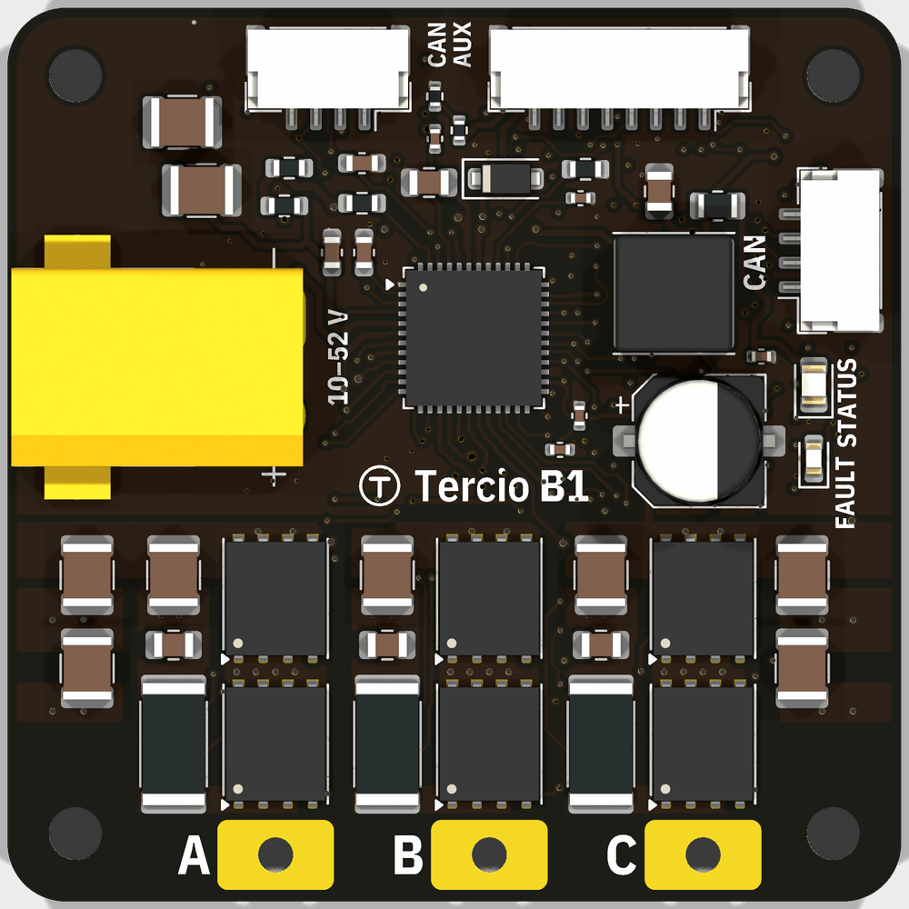
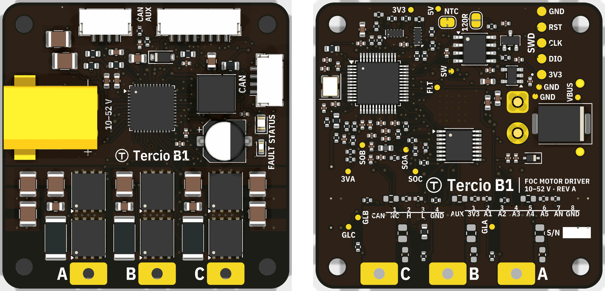
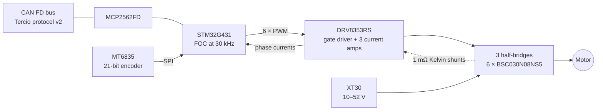
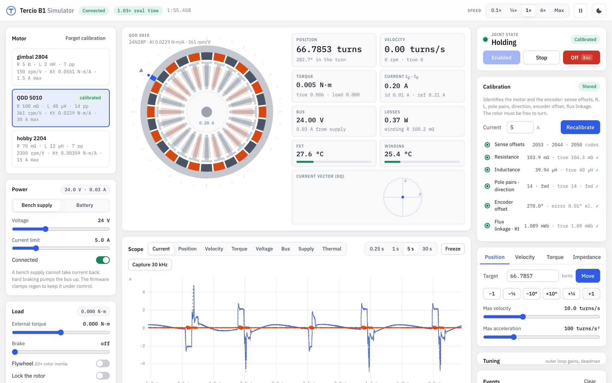

<div align="center">



# Tercio B1

**Brushless FOC on the Tercio bus.**

A 46 × 46 mm field-oriented-control driver for gimbal, quasi-direct-drive and hobby brushless motors.<br>
10–52 V, a 21-bit encoder on board, and the same bus, browser panel and libraries as the Tercio S1.

**Rev A is designed and 100 % routed, and its firmware runs on a simulated motor. Nothing has run on real hardware yet:<br>every rating on this page is a design target until the [bench tests](docs/08-bringup.md) confirm it.**

[Hardware](hardware/README.md) ·
[Firmware](firmware/README.md) ·
[Simulator](#simulator) ·
[Spec vs moteus](docs/02-spec-vs-x1.md) ·
[Plan](#documents)


</div>

---

## Why

A Tercio machine can already put closed-loop steppers and an IMU on one CAN bus, set up from a browser. Some joints want a brushless motor instead: gimbals that must be smooth at a crawl, legs and arms on quasi-direct-drive actuators, anything that needs torque control rather than position alone.

Good brushless controllers exist, but each comes with its own adapter, its own tools and its own library. The Tercio B1 joins the bus you already have. It speaks Tercio protocol v2 as device class 2, appears in Tercio Control next to your S1 drivers and IMUs, and is driven from the same Python and Arduino libraries. It aims at the mjbots moteus-x1 and moteus-n1 on that ecosystem and on value: a target of $99–119.

## Highlights (design targets)

| | |
|---|---|
| **On the Tercio bus** | Protocol v2, device class 2. Discovery, node IDs, parameters, telemetry and fault events work as on the S1, through the same Tercio FD adapter. |
| **21-bit encoder on board** | An MT6835 sits on the shaft axis under the board. The aux port takes an output-side encoder (SPI, I²C or quadrature), step/dir, RC PWM and a motor NTC. |
| **10–52 V, 80 V FETs** | A DRV8353RS 100 V-class gate driver with drain-source over-current protection, six 80 V / 3 mΩ BSC030N08NS5, 1 mΩ Kelvin shunts, and a regen clamp in firmware from day one. |
| **Fast loops** | PWM at 15–40 kHz (30 kHz by default), the current loop at the PWM rate, the position or velocity loop every second tick. |
| **Calibrates itself** | Measures current-sense offsets, resistance, inductance, pole pairs, direction, encoder offset and flux linkage. In simulation, R, L and flux linkage come out within 1 % on the 5010 and 2204 test motors; the gimbal's resistance reads 3.5 % high. |
| **Both bus speeds** | 500 k / 2.5 Mbit/s and 1 M / 5 Mbit/s bus profiles from the first release. |
| **Generated by code** | Schematic, placement, copper and routing are all Python that writes KiCad 10 files, authored by AI, and checked by KiCad itself: ERC 0, DRC 0, 0 schematic-parity issues. |

## Rev A board



- **46 × 46 mm, 6 layers**: 2 oz outer and 1 oz inner copper, 1.6 mm, matte black ENIG, filled and capped vias in pads.
- **Top:** the XT30 on the left edge; three half-bridges across the lower half, each low-side FET with its Kelvin shunt; phase pads A/B/C on the bottom edge; the DRV8353RS above them with its 5 V buck; CAN-in, aux and CAN-out connectors on the edges; status LEDs.
- **Bottom** (faces the motor, ≤ 2.3 mm parts): the MT6835 on the shaft axis, the STM32G431 beside the gate driver, the CAN transceiver between the connectors, SWD pads and a named test point for every rail and phase.
- **Numbers:** 163 footprints, 1,237 tracks, 340 vias, 100 % routed. BOM: 54 lines, every part in stock at JLCPCB when checked on 2026-10-13, $26.08 per board at 10 and $22.44 at 100 (components).
- **Fabrication:** `hardware/tools/jlc_fab.py` writes the gerbers, BOM and placement file for JLCPCB assembly.

## How it works



- **One call per PWM period.** `FocCore` takes the ADC sample and returns the duties: Clarke and Park transforms, a d/q current controller with decoupling and latency compensation, space-vector PWM and per-tick protection. It is plain C++ with no HAL, so the same code runs on the MCU, in the unit tests and in the simulator.
- **The joint.** `Joint` runs the protocol-v2 states, the position, velocity, torque and impedance modes on the S1's trajectory planner, the regen clamp, a 1 s host deadman and temperature derating.
- **Shared with the S1.** The trajectory planner and the encoder tracker come from the S1 firmware; the CAN node and the wear-levelled settings will too ([docs/07](docs/07-firmware.md) §7.3), so the B1 behaves like the rest of the Tercio bus.

## Simulator



The firmware above, unchanged, runs at 30 kHz in real time against a model of the motor and the board.

- **The model:** a dq motor with cogging and friction, dead time, a supply that cannot sink current, 12-bit current-sense codes, the encoder's noise and timing, and the gate driver's over-current latch.
- **The page:** pick a motor, run the calibration and see what it found next to the true values, then move the joint and watch the scope at 1 kHz, or one PWM period at a time.
- **Testing:** inject faults, load the shaft, or drag the rotor by hand.

```bash
cd firmware
node simulator/server.mjs             # http://127.0.0.1:8770, builds the simulator first if needed
```

## Specifications (design targets)

| | |
|---|---|
| **Supply** | 10–52 V (3S–12S, 48 V supplies); input TVS SMCJ54A; over-voltage fault ≤ 58 V |
| **Phase current** | ~80 A peak by design; 15 A continuous without cooling as the target. Both are published only after measurement. |
| **PWM and current loop** | 15–40 kHz, 30 kHz by default |
| **MCU** | STM32G431CBT6, Arm Cortex-M4F at 170 MHz (STM32G474CBT6 as a pin-compatible alternate) |
| **Power stage** | DRV8353RS, 6 × BSC030N08NS5 (80 V, 3.0 mΩ), 1 mΩ 2512 Kelvin shunts |
| **Encoder** | MT6835, 21-bit absolute, on board |
| **Aux port** | JST-GH 8: SPI, I²C, quadrature, step/dir, RC PWM, GPIO, motor NTC, 3.3 V (PTC-limited) |
| **Bus** | CAN FD, 500 k / 2.5 Mbit/s and 1 M / 5 Mbit/s, Tercio protocol v2; 2 × JST-GH 4 for daisy chaining; 120 Ω termination by solder jumper |
| **Power connector** | XT30 (right angle) and phase solder pads |
| **Board** | 46 × 46 mm, 6 layers, height ≤ 10 mm target, ≤ 16 g target |
| **Host tools** | Tercio Control in the browser and the Python and Arduino libraries, through the Tercio FD |

The comparison with moteus-x1, n1 and r4.11 is in [docs/02](docs/02-spec-vs-x1.md).

## Building it

### Firmware

```bash
cd firmware
~/.platformio/penv/bin/pio test -e native     # host tests on simulated motors
```

### Hardware

```bash
python3 hardware/build.py                      # schematic → netlist check → ERC → PDF
python3 -I hardware/verify_bom.py              # every LCSC code checked live against JLCPCB
```

The board scripts need KiCad 10's own Python, for `pcbnew`:

```bash
KPY=/Applications/KiCad/KiCad.app/Contents/Frameworks/Python.framework/Versions/3.9/bin/python3
cd hardware
$KPY layout.py                                 # place, copper, route, fill, DRC, renders
$KPY tools/jlc_fab.py                          # build/jlc: gerbers, BOM, CPL for JLCPCB
```

The files in `hardware/kicad/` are generated: change the code and regenerate rather than editing them in KiCad. The full flow, the router and the checks are in [hardware/README.md](hardware/README.md).

## Status and next steps

| | |
|---|---|
| **Done** | Plan and decisions; rev A schematic, board and routing, DRC clean; JLC fabrication files; firmware milestone F0 (FOC core, calibration, joint) with host tests 1–6 and the real-time simulator |
| **Next** | Regen and fault-reaction tests in simulation; the CAN and protocol layer; bring-up firmware; order rev A |
| **Schedule** | Rev A order around 21 December 2026, rev B after Chinese New Year, launch around June 2027 ([docs/09](docs/09-risks-schedule.md)) |
| **Guardrail** | The Tercio S1 and FD launch on 1 December 2026 comes first: no B1 changes to the other Tercio repositories before then, and a B1 freeze from 23 November to 7 December |

## Documents

| # | Document | Contents |
|---|---|---|
| 1 | [Requirements and the wedge](docs/01-requirements.md) | Decisions, functional requirements, positioning against moteus/ODrive, rating method |
| 2 | [Spec versus moteus-x1](docs/02-spec-vs-x1.md) | Side-by-side with x1, n1 and r4.11 |
| 3 | [Part shortlist](docs/03-parts.md) | Live LCSC/JLCPCB stock and prices (2026-10-12), choices and alternates |
| 4 | [Block diagram and pin map](docs/04-architecture.md) | Power tree, STM32G431 pin map, TIM1/ADC sync, aux and CAN connectors, floor plan |
| 5 | [BOM cost and PCB plan](docs/05-bom-pcb.md) | Planning estimate ≈ $45/board at 10, ≈ $25.50 at 100 (landed); stackup and layout rules |
| 6 | [KiCad as code](docs/06-kicad-as-code.md) | Python-generated schematic and board, routing, kicad-cli checks and outputs |
| 7 | [Firmware plan](docs/07-firmware.md) | S1 architecture reuse, FOC core, calibration and identification, protocol additions, bus profiles, host simulator |
| 8 | [Bring-up and test plan](docs/08-bringup.md) | Equipment, regen handling, 14 staged tests with pass criteria |
| 9 | [Risks and schedule](docs/09-risks-schedule.md) | Risk register; 3 spins; launch ~June 2027; ≈ $4,000–4,500 to launch |

## Repository layout

```text
docs/        the plan: requirements, spec, parts, architecture, BOM, KiCad as code, firmware, bring-up, risks
data/        live part data, BOM estimate, pin map
tools/       part lookup (JLCPCB + LCSC), BOM estimate, CAN bus-time budget
hardware/
├── b1/      the Tercio B1 circuit, one module per sheet; placement, copper, routing plan, silkscreen
├── gen/     the generator: KiCad file writer, symbols, footprints, board engine, router
├── tools/   JLCPCB fabrication files, routing report, XT30 3D model
├── kicad/   the generated KiCad 10 project (open tercio-b1.kicad_pro to review)
└── lib/     IBM Plex fonts for the silkscreen (project footprints and symbols are in kicad/lib/)
firmware/
├── src/     foc/, control/, app/ (MCU and host); sim/, simulator/ (host only)
├── simulator/  Node server and web UI
└── test/    host tests
```

## Data and tools

| Path | What |
|---|---|
| `tools/parts_lookup.py` | Live JLCPCB + LCSC stock and price lookup (standard library only). Reads `tools/candidates*.txt` |
| `tools/bom_estimate.py` | BOM cost at 10/100 boards from the lookup data → `data/bom-estimate.csv` |
| `tools/can_budget.py` | CAN FD bus-time budget per node and rate (`python3 tools/can_budget.py 1000000 5000000`) |
| `data/parts-live-2026-10-12*.csv` | 686 rows of live part data from 2026-10-12 |
| `data/pinmap-g431cbt6.csv` | Pin map as a table, for the generator |

Re-run before any order (stock moves daily):

```bash
python3 -I tools/parts_lookup.py && python3 -I tools/parts_lookup.py tools/candidates-extra.txt && python3 -I tools/bom_estimate.py
```

## Decision log

Decided with Kerol on 2026-10-12:

| Topic | Decision |
|---|---|
| Power class | Smaller class first → 10–52 V (DRV8353RS makes 12S/48 V possible) |
| Peak current | Design for ~80 A peak; lead marketing with continuous current |
| Target motors | Gimbal, QDD 5010/6010, small drone/hobby BLDC |
| Price | $99–119 |
| Size | ~46 × 46 mm |
| Encoder | Onboard MT6835 (21-bit) + aux port for an output-side encoder |
| MCU | STM32G431CBT6 (G474CBT6 as a pin-compatible alternate) |
| Gate driver | DRV8353RS |
| CAN connector | 2 × JST-GH 4-pin, daisy chain |
| Power connector | 1 × XT30 + motor solder pads |
| Extras | Motor thermistor, PWM and step/dir input, spare GPIO/analog |
| USB | No (CAN only, via the FD) |
| Bus | 500k/2.5M and 1M/5M, both from the B1's first release |
| Licence | Apache-2.0 |
| Name | Tercio B1 |
| KiCad flow | Code owns everything, including routing |
| Timing | Start the schematic now, in parallel with the launch |
| S1 and the 1M/5M bus | No S1s are built yet: the shipping firmware carries the bus profile |
| Repository | Private GitHub repo Kerol-Dev/Tercio-B1 (named Tercio-bldc until 2026-10-18) |

Still open:

| Topic | Notes |
|---|---|
| Weekly time cap before launch | Yours to set; the schedule assumes part-time |
| Electrolytic on board vs on the XT30 pigtail | Height (10 mm) vs cable damping. Rev A carries a 22 µF 100 V can on board |
| Mounting-hole pattern | Check against the 5010/6010 motors on rev A |
| Retail price inside $99–119, volume tiers, starter bundle | After rev B, when the BOM and ratings are firm |

## Licence

Apache-2.0, see [LICENSE](LICENSE).

<div align="center">
<sub>Made by <a href="https://terciolabs.com">Tercio Labs</a></sub>
</div>
