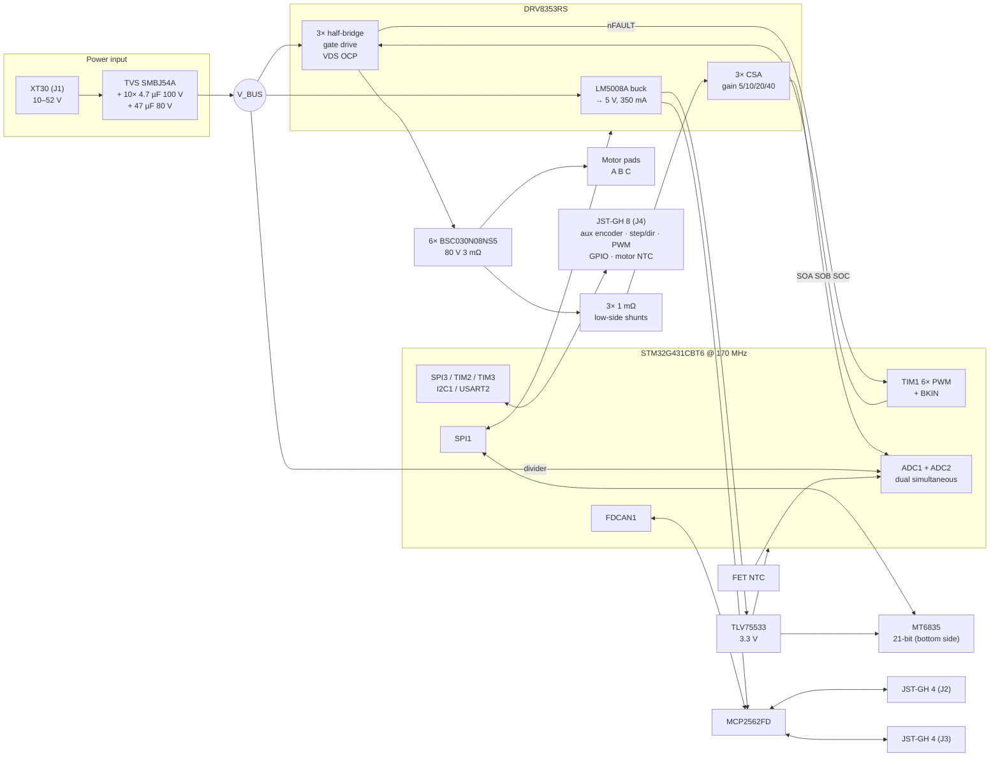

# 4. Block diagram and first pin map

Status: rev A, 2026-10-12. **The generated schematic (`hardware/b1/`) is now the
source of truth; this page explains it.** The pin map was checked against two sources
already on this Mac: KiCad 10's `STM32G431CBTx` symbol (ST open pin data) and
the STM32duino `G431C(6-8-B)T` variant tables. Alternate-function numbers are
given where those tables state them.

## 4.1 Block diagram



Power tree and budget:

| Rail | Source | Loads | Budget |
|---|---|---|---|
| V_BUS 10–52 V | XT30 | Bridge, DRV8353 VM (gate drive comes from VM through its charge pump and VGLS regulator) | — |
| 5 V | DRV8353R buck (LM5008A, 350 mA max) | MCP2562FD VDD (~70 mA dominant), LDO input | ≤ 250 mA planned |
| 3.3 V | TLV75533 (from 5 V) | MCU ~40 mA, MT6835 ~22 mA, transceiver VIO, LEDs, aux 3.3 V out | ≤ 150 mA (aux output limited to 50 mA) |
| VDDA / VREF+ | 3.3 V through a ferrite and 1 µF + 10 nF | ADC reference **and** DRV8353 VREF | — |

The DRV's CSA output is biased at VREF/2. Feeding VREF and the ADC reference
from the same filtered rail makes current sensing ratiometric, so 3.3 V drift
cancels out.

## 4.2 Pin map (STM32G431CBT6, LQFP-48)

Same package, pinout and core variant as the S1 and IMU. The STM32G474CBT6 is
pin-compatible and every assignment below exists on it too, so it stays a
drop-in alternate.

The free pins (GPIOs and ADC channels) face where their signals go on the board.
The MCU sits on the bottom beside the DRV8353, rotated 180°. The PWM inputs and
DRV_CS are 1–4 mm from their driver pins, the aux pins face the aux connector,
and the current-sense inputs face the DRV's SO pins.

| Pin | Port | Net | Function (AF) | Notes |
|---:|---|---|---|---|
| 1 | VBAT | 3V3 | — | Tied to VDD (the S1 left it unconnected; ST requires a connection) |
| 2 | PC13 | LED_FAULT | GPIO | Low-drive pin, sinks ≤ 3 mA. Red LED anode on 3V3 |
| 3 | PC14 | LED_STATUS | GPIO | Low-drive pin, sinks ≤ 3 mA. Green LED anode on +5V (V_F ≈ 2.9 V) |
| 4 | PC15 | ENC_CAL | GPIO | MT6835 CAL_EN (pin 4): a low→high edge while spinning starts the on-chip self-calibration. The MCP2562FD STBY pin is tied to GND (always active) |
| 5 | PF0 | OSC_IN | HSE | 16 MHz crystal, same part as the S1/FD (C13738) |
| 6 | PF1 | OSC_OUT | HSE | |
| 7 | PG10 | NRST | — | 100 nF to GND (missing on the S1), Tag-Connect |
| 8 | PA0 | VPH_B | ADC1_IN1 | Optional phase-voltage divider, not fitted on rev A |
| 9 | PA1 | NTC_FET | ADC1_IN2 | NTC between the low-side FETs |
| 10 | PA2 | AUX_ANA | ADC1_IN3 | Motor NTC or 0–3.3 V analog on aux pin 7. 10 k pull-up selected by solder jumper |
| 11 | PA3 | VPH_C | ADC1_IN4 | Optional, not fitted |
| 12 | PA4 | VBUS_SENSE | ADC2_IN17 | Divider sized for 0–60 V |
| 13 | PA5 | SPI1_SCK | SPI1 (AF5) | Encoder + DRV8353, through a 22 Ω source resistor (MOSI too; MISO has its own at the MT6835) |
| 14 | PA6 | SPI1_MISO | SPI1 (AF5) | |
| 15 | PA7 | SPI1_MOSI | SPI1 (AF5) | |
| 16 | PB0 | CSA_B | ADC1_IN15 | DRV SOB |
| 17 | PB1 | CSA_C | ADC1_IN12 | DRV SOC. ADC3_IN1 on a G474 |
| 18 | PB2 | CSA_A | ADC2_IN12 | DRV SOA |
| 19–21 | VSSA, VREF+, VDDA | | | VREF+ = filtered VDDA |
| 22 | PB10 | DRV_nFAULT | TIM1_BKIN | Open drain, pull-up. A fault stops PWM in hardware. AF number: check RM0440/DS (listed in the KiCad pin data) |
| 25 | PB11 | DRV_CS | GPIO | DRV8353 SPI chip select |
| 26 | PB12 | VPH_A | ADC1_IN11 | Optional, not fitted |
| 27 | PB13 | INLA | TIM1_CH1N (AF6) | |
| 28 | PB14 | INLB | TIM1_CH2N (AF6) | Same pin and AF as the S1's STEP output |
| 29 | PB15 | INLC | TIM1_CH3N (AF4) | |
| 30 | PA8 | INHA | TIM1_CH1 (AF6) | |
| 31 | PA9 | INHB | TIM1_CH2 (AF6) | |
| 32 | PA10 | INHC | TIM1_CH3 (AF6) | |
| 33 | PA11 | CAN_RX | FDCAN1 (AF9) | Same as S1, so `CanBus` is reused unchanged |
| 34 | PA12 | CAN_TX | FDCAN1 (AF9) | |
| 37 | PA13 | SWDIO | SWD | Tag-Connect TC2030 pads: 3V3, SWDIO, SWCLK, NRST, GND (the S1's J3 had no GND) |
| 38 | PA14 | SWCLK | SWD | |
| 39 | PA15 | AUX1 | SPI3_NSS (AF6) · TIM2_CH1/ETR (AF1) · USART2_RX (AF7) · I2C1_SCL (AF4) | |
| 40 | PB3 | AUX2 | SPI3_SCK (AF6) · TIM2_CH2 (AF1) · USART2_TX (AF7) | Costs the SWO trace pin |
| 41 | PB4 | AUX3 | SPI3_MISO (AF6) · TIM3_CH1 (AF2) · USART2_RX (AF7) | |
| 42 | PB5 | AUX4 | SPI3_MOSI (AF6) · TIM3_CH2 (AF2) · I2C3_SDA | |
| 43 | PB6 | ENC_CS | GPIO | MT6835 chip select |
| 44 | PB7 | AUX5 | I2C1_SDA (AF4) · USART1_RX (AF7) · TIM3_CH4 (AF10) | |
| 45 | PB8 | BOOT0 | — | 10 k pull-down (S1 lesson). Not used as GPIO |
| 46 | PB9 | DRV_EN | GPIO | 100 k pull-down: bridge driver off while the MCU is in reset (the S1's R24 lesson) |
| 23, 35, 47 / 24, 36, 48 | VSS / VDD | | | 100 nF per pin + 4.7 µF bulk |

### Aux connector (J4, JST-GH 8-pin)

| GH pin | Signal | SPI encoder | I2C encoder | Quadrature | Step/dir | RC PWM | UART |
|---:|---|---|---|---|---|---|---|
| 1 | 3V3 out (≤ 50 mA) | VCC | VCC | VCC | — | — | — |
| 2 | AUX1 PA15 | CS | SCL | A (TIM2_CH1) | STEP (TIM2_CH1) | — | RX |
| 3 | AUX2 PB3 | SCK | — | B (TIM2_CH2) | DIR (TIM2_CH2) | — | TX |
| 4 | AUX3 PB4 | MISO | — | — | ENABLE | PWM in (TIM3_CH1) | — |
| 5 | AUX4 PB5 | MOSI | — | — | — | — | — |
| 6 | AUX5 PB7 | — | SDA | Z (EXTI) | — | — | — |
| 7 | AUX_ANA PA2 | motor NTC / analog in | | | | | |
| 8 | GND | | | | | | |

Every aux line has a series resistor (~47 Ω) and a TPD4E05U06 ESD array. Step/dir and
quadrature share TIM2. The G4 timers have a "clock plus direction" encoder
mode, so step/dir needs no CPU per pulse, like the S1's TIM1 step output.
Confirm that mode in RM0440 for TIM2 before the schematic freezes. The I2C
mode lets the S1's AS5600 driver serve as an output-side encoder.

### CAN connectors (J2, J3, JST-GH 4-pin, daisy chain)

| Pin | Signal | Note |
|---:|---|---|
| 1 | NC (reserved) | Pixhawk/DroneCAN GH cables carry 5 V here; leaving it unconnected keeps those cables safe |
| 2 | CAN_H | |
| 3 | CAN_L | |
| 4 | GND | |

The 120 Ω split termination (2 × 60 Ω + 4.7 nF to GND) is enabled by a solder
jumper, the board-size equivalent of the S1's J9. PESD2CAN ESD sits at the
connectors. Ship GH-to-bare-wire cables for the S1's 2.54 mm terminals and the
FD's JST-XH.

## 4.3 Timer and ADC synchronisation

| Item | Setting |
|---|---|
| TIM1 | Centre-aligned mode, ARR = 170 MHz / (2 · f_PWM), so 2833 at 30 kHz. Repetition counter 1, so registers update at the valley only. Dead time from the DTG field (~150 ns start), and the DRV8353 enforces its own minimum too. 6× PWM mode on the DRV |
| Break | BKIN = DRV nFAULT (active low). Break disables all six outputs to their idle (off) state in hardware |
| Encoder read | TIM1 CH4 compare at the counter peak starts the SPI1 DMA read of the MT6835 (~3 µs at 16 MHz), so the sample is fresh when the ADC interrupt runs half a period later |
| Current sampling | TRGO2 = OC4REF placed so conversion happens at the valley, when all low-side FETs are on and the shunts carry phase current |
| ADC1 ‖ ADC2 injected, dual simultaneous | Rank 1: I_B (PB0, ADC1_IN15) ‖ I_A (PB2, ADC2_IN12). Rank 2: I_C (PB1, ADC1_IN12) ‖ V_BUS (PA4, ADC2_IN17) |
| ADC1 regular (DMA, ~1 kHz) | FET NTC, aux analog, internal temperature, VREFINT, optional phase voltages |
| Interrupt | ADC JEOS → FocTick at the highest priority. FDCAN, SPI DMA and SysTick sit below it |
| Encoder + driver on one SPI | The ISR owns SPI1. The main loop queues DRV8353 register accesses in a mailbox, which the ISR serves after the encoder read. MT6835 uses SPI mode 3 and the DRV8353 mode 1, so CPHA/CPOL are switched between transfers |

With all three currents sampled, the firmware drops the phase with the
shortest low-side window at high modulation and reconstructs it from the
other two (i_a + i_b + i_c = 0).

On a G474 fitted later, ADC3 can take I_C at rank 1 too (PB1 is ADC3_IN1),
sampling all three phases at once, with no layout change: the pin map puts I_C
on PB1 for that reason too.

## 4.4 Board floor plan (rev A, as laid out)

Seen from the top; bottom-side parts in parentheses, connectors in brackets.

```
 46 mm
┌────────────────────────────────────────────┐
│ ◯   [J2 CAN in]          [J4 aux GH-8]   ◯ │  ← cable entries on the top edge
│  VM/VDRAIN filters   buck   (aux ESD, R)   │
│  (SWD pads, MCP2562FD, LDO)                │
│ [XT30]     DRV8353RS  ¦  (G431, 180°) [J3  │  ← CAN out on the right edge
│ power in   (MT6835 on ¦  via lane      CAN]│
│             the axis) ¦  (analog RC, HSE)  │
│  bulk MLCC slots around each leg   22 µF   │
│  Q_HS A        Q_HS B        Q_HS C        │
│  shunt, Q_LS   shunt, Q_LS   shunt, Q_LS   │
│ ◯    ▣ A          ▣ B          ▣ C       ◯ │  ← motor pads on the bottom edge
└────────────────────────────────────────────┘
```

- Top: power input, the three half-bridges, the DRV8353RS and its buck, connectors, LEDs.
- Bottom (≤ 2.3 mm parts, faces the motor): the MT6835 on the shaft axis, the MCU beside the
  DRV, rotated so its PWM / chip-select pins face the DRV's control pins across a via lane
  and its aux pins face the aux connector; the CAN transceiver between the CAN connectors;
  the LDO, SWD pads, test points and the input TVS. Under the power stage the bottom carries
  only gate resistors, the NTC, phase taps and DNP snubbers, so it stays free for a heat
  spreader.
- 6 layers: F · In1 GND · In2 signals (V_BUS plane under the power stage) · In3 signals
  (+3V3 fill under the logic, GND fill under the power stage) · In4 GND · B.
- Mounting holes: 4 × M2.5 at ±19.5 mm, pattern to be confirmed against the target motors
  (5010/6010 back covers).
