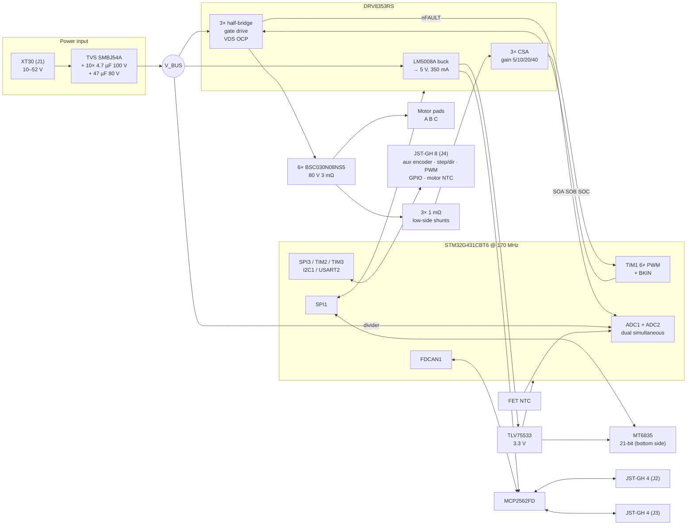

# 4. Block diagram and first pin map

Status: rev A plan, 2026-10-12. The pin map was checked against two sources
already on this Mac: KiCad 10's `STM32G431CBTx` symbol (ST open pin data) and
the STM32duino `G431C(6-8-B)T` variant tables. Alternate-function numbers are
given where those tables state them.

## 4.1 Block diagram



Power tree and budget:

| Rail | Source | Loads | Budget |
|---|---|---|---|
| V_BUS 10–52 V | XT30 | Bridge, DRV8353 VM (gate drive comes from VM through its charge pump and VGLS regulator) | — |
| 5 V | DRV8353R buck (LM5008A, 350 mA max) | MCP2562FD VDD (~70 mA dominant), LDO input | ≤ 250 mA planned |
| 3.3 V | TLV75533 (from 5 V) | MCU ~40 mA, MT6835 ~22 mA, transceiver VIO, LEDs, aux 3.3 V out | ≤ 150 mA (aux output limited to 50 mA) |
| VDDA / VREF+ | 3.3 V through a ferrite and 1 µF + 10 nF | ADC reference **and** DRV8353 VREF | — |

The DRV's CSA output is biased at VREF/2. Feeding VREF and the ADC reference
from the same filtered rail makes current sensing ratiometric, so 3.3 V drift
cancels out.

## 4.2 Pin map (STM32G431CBT6, LQFP-48)

Same package, pinout and core variant as the S1 and IMU. The STM32G474CBT6 is
pin-compatible and every assignment below exists on it too, so it stays a
drop-in alternate.

| Pin | Port | Net | Function (AF) | Notes |
|---:|---|---|---|---|
| 1 | VBAT | 3V3 | — | Tied to VDD (the S1 left it unconnected; ST requires a connection) |
| 2 | PC13 | LED_STATUS | GPIO | Low-drive pin, LED sinks ≤ 3 mA |
| 3 | PC14 | LED_FAULT | GPIO | Low-drive pin |
| 4 | PC15 | CAN_STBY | GPIO | MCP2562FD STBY has an internal pull-up, so the transceiver stays in standby until firmware drives this low |
| 5 | PF0 | OSC_IN | HSE | 16 MHz crystal, same part as the S1/FD (C13738) |
| 6 | PF1 | OSC_OUT | HSE | |
| 7 | PG10 | NRST | — | 100 nF to GND (missing on the S1), Tag-Connect |
| 8 | PA0 | CSA_A | ADC12_IN1 | DRV SOA. On both ADC1 and ADC2 |
| 9 | PA1 | CSA_B | ADC12_IN2 | DRV SOB. On both ADCs |
| 10 | PA2 | AUX_ANA | ADC1_IN3 | Motor NTC or 0–3.3 V analog on aux pin 7. 10 k pull-up selected by solder jumper |
| 11 | PA3 | NTC_FET | ADC1_IN4 | NTC between the low-side FETs |
| 12 | PA4 | ENC_CS | GPIO | MT6835 chip select |
| 13 | PA5 | SPI1_SCK | SPI1 (AF5) | Encoder + DRV8353 |
| 14 | PA6 | SPI1_MISO | SPI1 (AF5) | |
| 15 | PA7 | SPI1_MOSI | SPI1 (AF5) | |
| 16 | PB0 | VPH_A | ADC1_IN15 | Optional phase-voltage divider, not fitted on rev A |
| 17 | PB1 | VPH_B | ADC1_IN12 | Optional, not fitted |
| 18 | PB2 | VBUS_SENSE | ADC2_IN12 | Divider sized for 0–60 V |
| 19–21 | VSSA, VREF+, VDDA | | | VREF+ = filtered VDDA |
| 22 | PB10 | DRV_nFAULT | TIM1_BKIN | Open drain, pull-up. A fault stops PWM in hardware. AF number: check RM0440/DS (listed in the KiCad pin data) |
| 25 | PB11 | CSA_C | ADC12_IN14 | DRV SOC. On both ADCs |
| 26 | PB12 | VPH_C | ADC1_IN11 | Optional, not fitted |
| 27 | PB13 | INLA | TIM1_CH1N (AF6) | |
| 28 | PB14 | INLB | TIM1_CH2N (AF6) | Same pin and AF as the S1's STEP output |
| 29 | PB15 | INLC | TIM1_CH3N (AF4) | |
| 30 | PA8 | INHA | TIM1_CH1 (AF6) | |
| 31 | PA9 | INHB | TIM1_CH2 (AF6) | |
| 32 | PA10 | INHC | TIM1_CH3 (AF6) | |
| 33 | PA11 | CAN_RX | FDCAN1 (AF9) | Same as S1, so `CanBus` is reused unchanged |
| 34 | PA12 | CAN_TX | FDCAN1 (AF9) | |
| 37 | PA13 | SWDIO | SWD | Tag-Connect TC2030 pads: 3V3, SWDIO, SWCLK, NRST, GND (the S1's J3 had no GND) |
| 38 | PA14 | SWCLK | SWD | |
| 39 | PA15 | AUX1 | SPI3_NSS (AF6) · TIM2_CH1/ETR (AF1) · USART2_RX (AF7) · I2C1_SCL (AF4) | |
| 40 | PB3 | AUX2 | SPI3_SCK (AF6) · TIM2_CH2 (AF1) · USART2_TX (AF7) | Costs the SWO trace pin |
| 41 | PB4 | AUX3 | SPI3_MISO (AF6) · TIM3_CH1 (AF2) · USART2_RX (AF7) | |
| 42 | PB5 | AUX4 | SPI3_MOSI (AF6) · TIM3_CH2 (AF2) · I2C3_SDA | |
| 43 | PB6 | DRV_CS | GPIO | DRV8353 SPI chip select |
| 44 | PB7 | AUX5 | I2C1_SDA (AF4) · USART1_RX (AF7) · TIM3_CH4 (AF10) | |
| 45 | PB8 | BOOT0 | — | 10 k pull-down (S1 lesson). Not used as GPIO |
| 46 | PB9 | DRV_EN | GPIO | 100 k pull-down: bridge driver off while the MCU is in reset (the S1's R24 lesson) |
| 23, 35, 47 / 24, 36, 48 | VSS / VDD | | | 100 nF per pin + 4.7 µF bulk |

### Aux connector (J4, JST-GH 8-pin)

| GH pin | Signal | SPI encoder | I2C encoder | Quadrature | Step/dir | RC PWM | UART |
|---:|---|---|---|---|---|---|---|
| 1 | 3V3 out (≤ 50 mA) | VCC | VCC | VCC | — | — | — |
| 2 | AUX1 PA15 | CS | SCL | A (TIM2_CH1) | STEP (TIM2_CH1) | — | RX |
| 3 | AUX2 PB3 | SCK | — | B (TIM2_CH2) | DIR (TIM2_CH2) | — | TX |
| 4 | AUX3 PB4 | MISO | — | — | ENABLE | PWM in (TIM3_CH1) | — |
| 5 | AUX4 PB5 | MOSI | — | — | — | — | — |
| 6 | AUX5 PB7 | — | SDA | Z (EXTI) | — | — | — |
| 7 | AUX_ANA PA2 | motor NTC / analog in | | | | | |
| 8 | GND | | | | | | |

Every aux line has a series resistor (~47 Ω) and a TPD4E05U06 ESD array. Step/dir and
quadrature share TIM2. The G4 timers have a "clock plus direction" encoder
mode, so step/dir needs no CPU per pulse, like the S1's TIM1 step output.
Confirm that mode in RM0440 for TIM2 before the schematic freezes. The I2C
mode lets the S1's AS5600 driver serve as an output-side encoder.

### CAN connectors (J2, J3, JST-GH 4-pin, daisy chain)

| Pin | Signal | Note |
|---:|---|---|
| 1 | NC (reserved) | Pixhawk/DroneCAN GH cables carry 5 V here; leaving it unconnected keeps those cables safe |
| 2 | CAN_H | |
| 3 | CAN_L | |
| 4 | GND | |

The 120 Ω split termination (2 × 60 Ω + 4.7 nF to GND) is enabled by a solder
jumper, the board-size equivalent of the S1's J9. PESD2CAN ESD sits at the
connectors. Ship GH-to-bare-wire cables for the S1's 2.54 mm terminals and the
FD's JST-XH.

## 4.3 Timer and ADC synchronisation

| Item | Setting |
|---|---|
| TIM1 | Centre-aligned mode, ARR = 170 MHz / (2 · f_PWM), so 2833 at 30 kHz. Repetition counter 1, so registers update at the valley only. Dead time from the DTG field (~150 ns start), and the DRV8353 enforces its own minimum too. 6× PWM mode on the DRV |
| Break | BKIN = DRV nFAULT (active low). Break disables all six outputs to their idle (off) state in hardware |
| Encoder read | TIM1 CH4 compare at the counter peak starts the SPI1 DMA read of the MT6835 (~3 µs at 16 MHz), so the sample is fresh when the ADC interrupt runs half a period later |
| Current sampling | TRGO2 = OC4REF placed so conversion happens at the valley, when all low-side FETs are on and the shunts carry phase current |
| ADC1 ‖ ADC2 injected, dual simultaneous | Rank 1: I_A (PA0, ADC1_IN1) ‖ I_B (PA1, ADC2_IN2). Rank 2: I_C (PB11, ADC1_IN14) ‖ V_BUS (PB2, ADC2_IN12) |
| ADC1 regular (DMA, ~1 kHz) | FET NTC, aux analog, internal temperature, VREFINT, optional phase voltages |
| Interrupt | ADC JEOS → FocTick at the highest priority. FDCAN, SPI DMA and SysTick sit below it |
| Encoder + driver on one SPI | The ISR owns SPI1. The main loop queues DRV8353 register accesses in a mailbox, which the ISR serves after the encoder read. MT6835 uses SPI mode 3 and the DRV8353 mode 1, so CPHA/CPOL are switched between transfers |

With all three currents sampled, the firmware drops the phase with the
shortest low-side window at high modulation and reconstructs it from the
other two (i_a + i_b + i_c = 0).

On a G474 fitted later, ADC3 could take I_C at rank 1 too (PB1 is ADC3_IN1),
sampling all three phases at once. That needs a 0 Ω option on the layout, so
it is noted here and not planned.

## 4.4 Board floor plan (rev A intent)

```
 46 mm
┌───────────────────────────────────────────┐
│ [J2 GH4]                        [J3 GH4]  │  ← CAN in/out on one edge
│  MCP2562FD   G431 (top)   DRV8353RS       │
│                                           │
│ [J4 GH8]     ◯ MT6835 (bottom, centre)    │  ← encoder under the board centre, magnet below
│                                           │
│  Q1/Q2  Q3/Q4  Q5/Q6   3 shunts          │  ← one row of half-bridges, bulk MLCCs straddling each leg
│  ▣ A    ▣ B    ▣ C     [J1 XT30]         │  ← motor pads and power on the opposite edge
└───────────────────────────────────────────┘
```

- Two-sided assembly: the bottom carries the MT6835 and its decoupling only.
  The top carries everything else, including the thermal path from the FETs
  through vias into the inner planes.
- Mounting holes: 4 × M2.5, pattern to be chosen against the target motors
  (5010/6010 back covers) during layout.
